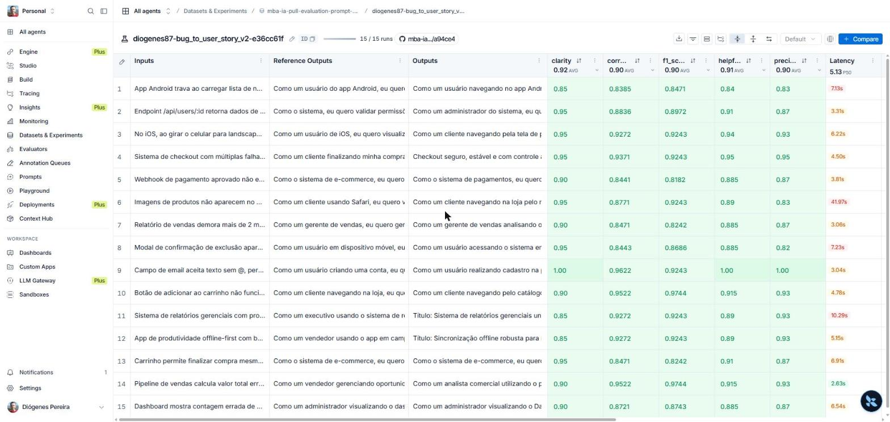
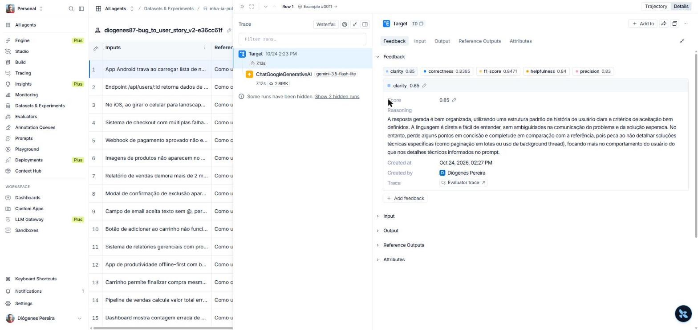
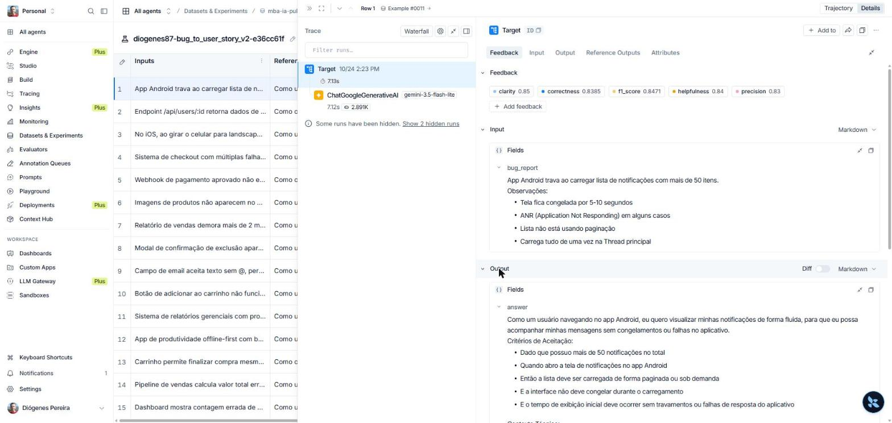
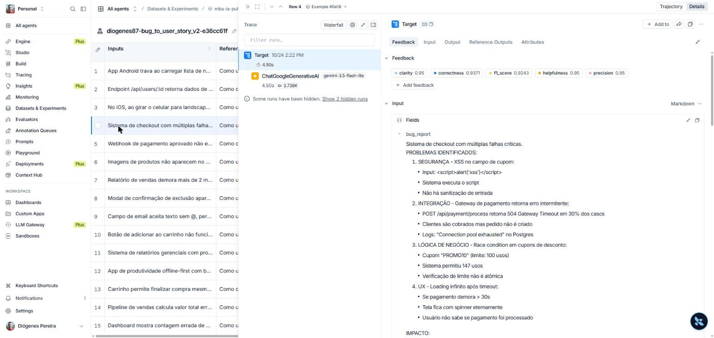
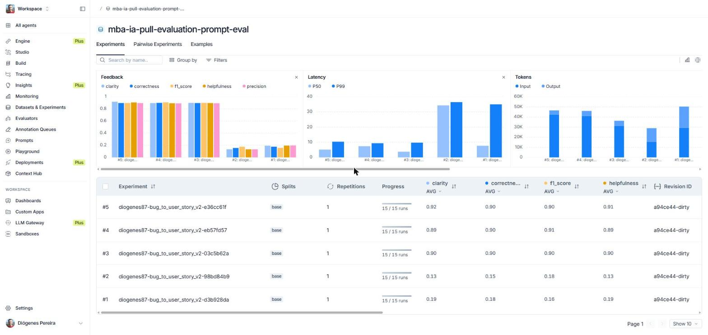

# Pull, Otimização e Avaliação de Prompts com LangChain e LangSmith

Entrega do desafio técnico **"Pull, Otimização e Avaliação de Prompts com LangChain e
LangSmith"** do MBA em Engenharia de Software com IA (Full Cycle), por **diogenes87**.

Pipeline local em Python que:

1. Faz **pull** do prompt semente de baixa qualidade (`leonanluppi/bug_to_user_story_v1`) do LangSmith Prompt Hub;
2. Refatora o prompt aplicando técnicas avançadas de Prompt Engineering (prompt `v2`);
3. Faz **push** do prompt otimizado, público, de volta ao Hub (`diogenes87/bug_to_user_story_v2`);
4. Avalia a qualidade com 5 métricas (Helpfulness, Correctness, F1-Score, Clarity, Precision) via LLM-as-judge contra um dataset de 15 bugs reais;
5. Itera até todas as métricas baterem a meta.

> O enunciado oficial completo do desafio (retirado da plataforma Full Cycle) está
> preservado na seção [Sobre o desafio original](#sobre-o-desafio-original), no final
> deste arquivo.

---

## Técnicas Aplicadas (Fase 2)

O prompt `prompts/bug_to_user_story_v2.yml` aplica três técnicas de prompt engineering,
registradas nos metadados `techniques_applied` do próprio YAML:

### 1. Role Prompting (persona)

O `system_prompt` abre definindo uma persona especialista
(`prompts/bug_to_user_story_v2.yml`, linhas 20-24):

> "Você é um Product Manager / Business Analyst sênior, especialista em Engenharia de
> Requisitos Ágeis, com mais de 10 anos de experiência transformando relatos de bugs
> reportados por QA, suporte ou clientes em User Stories claras, acionáveis..."

**Por quê:** o prompt v1 não define nenhuma persona ("Você é um assistente que ajuda a
transformar..."), o que produz respostas genéricas e sem padrão de qualidade. Ancorar o
modelo numa persona sênior eleva o nível de detalhe, o vocabulário ágil correto
(User Story, Critérios de Aceitação, Given-When-Then) e a consistência entre respostas.

### 2. Few-shot Learning (obrigatório)

Três exemplos completos de entrada → saída (`prompts/bug_to_user_story_v2.yml`, linhas
127-213), cobrindo os três padrões mais importantes do dataset:

- **Exemplo 1** — bug simples, persona humana (cliente favoritando um produto);
- **Exemplo 2** — bug complexo, múltiplos problemas no mesmo relato (checkout com
  segurança + performance + lógica de negócio), demonstrando a estrutura em grupos
  (A, B, C...) com Título, Critérios Técnicos, Contexto do Bug e Tasks Técnicas;
- **Exemplo 3** — bug médio com **persona "sistema"** (validação de estoque no
  checkout), ensinando o modelo a diferenciar quando a responsabilidade é de
  *enforcement* automático do backend em vez de uma ação do usuário.

**Por quê:** few-shot é a técnica obrigatória do desafio, e é a que melhor resolve o
problema central do v1 — a ausência total de exemplos fazia o modelo "adivinhar" o
formato de saída, gerando respostas inconsistentes de um bug para outro. Dar 2-3
exemplos completos (entrada → saída) ancora o formato exato esperado (User Story +
Critérios de Aceitação no padrão Given-When-Then) de forma muito mais confiável do que
apenas descrever o formato em texto. Na prática, foi a técnica que mais moveu as
métricas entre as iterações (ver "Diário de Iteração" abaixo): sem o Exemplo 3, o
modelo tendia a usar sempre a persona humana, mesmo quando a referência do dataset usa
"Como o sistema...", o que derrubava Precision e F1-Score.

### 3. Chain of Thought (CoT)

O `system_prompt` instrui um raciocínio interno em 7 passos antes da resposta final
(`prompts/bug_to_user_story_v2.yml`, linhas 32-69: identificar ator → ação → benefício
→ complexidade → critérios Given-When-Then → contexto técnico → revisão), com instrução
explícita para **não mostrar o raciocínio**, apenas o resultado:

> "1. Identifique QUEM é afetado pelo bug: um usuário final... ou o próprio
> sistema/backend. Use a persona "sistema" quando a correção é uma responsabilidade de
> ENFORCEMENT AUTOMÁTICO do backend... 5. (...) Se o relato menciona uma MÉTRICA ATUAL
> problemática (ex: "demora 120s"), NUNCA repita esse número como se fosse a meta..."

**Por quê:** decompor o problema em passos reduz omissões (ex.: esquecer critérios de
aceitação de edge case) e, principalmente, força uma decisão explícita sobre a persona
e sobre como tratar métricas/edge cases antes de escrever a resposta — o ponto que mais
derrubava a métrica **Precision** nas primeiras iterações.

### Outras técnicas do enunciado consideradas e descartadas

- **Tree of Thought / ReAct**: desnecessárias para uma tarefa de transformação de texto
  em um único turno, sem ferramentas externas nem exploração de múltiplos caminhos.
- **Skeleton of Thought**: a "Regra de adaptação por complexidade" do prompt já cumpre
  esse papel (define de antemão quais seções a resposta deve ter, por nível de
  complexidade do bug), sem precisar de uma técnica separada.

### Outros problemas do v1 corrigidos no v2

| Problema no v1 | Correção no v2 |
|---|---|
| `{bug_report}` duplicado no `system_prompt` **e** no `user_prompt` | `user_prompt` ficou só `"{bug_report}"`; todo o contexto/instrução vive no `system_prompt` |
| Sem persona | Role Prompting (seção acima) |
| Sem exemplos | Few-shot com 3 exemplos (seção acima) |
| Sem regras de comportamento explícitas | Seção "Regras explícitas de comportamento" (formato Given-When-Then, proibição de invenção de dados, tom profissional, idioma) |
| Sem tratamento de edge case | Regras para: bug simples/médio/complexo, persona "sistema", relato vazio, condição de corrida, acessibilidade em UI, métrica-alvo vs métrica atual |
| Sem definição clara de formato de saída | Seção "Formato de saída" + System vs User Prompt bem separados |

---

## Resultados Finais

### Critério de aprovação exigido pelo desafio

> Helpfulness ≥ 0.8, Correctness ≥ 0.8, F1-Score ≥ 0.8, Clarity ≥ 0.8, Precision ≥ 0.8,
> e a MÉDIA das 5 métricas ≥ 0.8. **Todas** as 5 métricas precisam estar ≥ 0.8, não só
> a média — este é o critério de aprovação do enunciado oficial, aplicado literalmente
> em código por `APPROVAL_THRESHOLD = 0.8` em `src/evaluate.py` (arquivo "pronto", não
> alterado nesta entrega).

### Resultado obtido pelo prompt v2 (última avaliação, 15/15 exemplos)

| Métrica | Nota obtida | Exigido | Status |
|---|---|---|---|
| Helpfulness | **0.91** | ≥ 0.8 | ✅ Aprovado |
| Correctness | **0.90** | ≥ 0.8 | ✅ Aprovado |
| F1-Score | **0.90** | ≥ 0.8 | ✅ Aprovado |
| Clarity | **0.92** | ≥ 0.8 | ✅ Aprovado |
| Precision | **0.90** | ≥ 0.8 | ✅ Aprovado |
| **Média geral** | **0.9021** | ≥ 0.8 | ✅ **APROVADO** |

**Todas as 5 métricas ficaram acima de 0.9**, superando o critério de aprovação (0.8)
com folga confortável de +0.10 a +0.12 em cada métrica. Esse resultado é o impresso
real do terminal ao rodar `python src/evaluate.py` na última iteração (ver "Diário de
iteração" abaixo) e está gravado como feedback no experimento do LangSmith, visível no
link público da seção "Evidências no LangSmith".

Provider usado: **Google Gemini** (`LLM_PROVIDER=google`), modelo
`gemini-3.5-flash-lite` tanto para responder (`LLM_MODEL`) quanto para avaliar
(`EVAL_MODEL`) — ver nota sobre escolha de modelo na seção "Como Executar".

### Comparação v1 (baixa qualidade) vs v2 (otimizado)

O v1 nunca foi avaliado formalmente pelo pipeline (o `src/evaluate.py` do desafio só
avalia o prompt `v2`, puxado do Hub) — os números de v1 abaixo são o exemplo
**ilustrativo** do enunciado oficial do desafio, mostrado para dar a ordem de grandeza
do ponto de partida:

| Métrica | v1 (ilustrativo, enunciado) | v2 (medido, real) |
|---|---|---|
| Helpfulness | 0.45 ✗ | **0.91** ✓ |
| Correctness | 0.52 ✗ | **0.90** ✓ |
| F1-Score | 0.48 ✗ | **0.90** ✓ |
| Clarity | 0.50 ✗ | **0.92** ✓ |
| Precision | 0.46 ✗ | **0.90** ✓ |

**O que mudou estruturalmente** (ver tabela completa na seção anterior): persona
definida, few-shot obrigatório, chain-of-thought, regras explícitas de comportamento,
tratamento de edge cases e separação correta de `{bug_report}` entre system/user prompt
— o v1 duplicava a variável e não tinha nenhuma das técnicas acima.

### Diário de iteração

Como o enunciado pede (3–5 iterações esperadas), documentamos as 5 tentativas reais,
incluindo duas que falharam por limite de cota do provedor (não por qualidade do
prompt) — ambas ficam visíveis no dataset público (seção seguinte) como parte honesta
do processo:

| # | O que mudou | Resultado |
|---|---|---|
| 1 e 2 | Primeira versão do prompt v2, rodada contra `gemini-2.5-flash` e depois `gemini-3.5-flash` | ❌ **Bloqueado por cota**: ambos os modelos "Flash" (não-lite) têm free tier de só **20 requisições/dia** na API Gemini atual — a avaliação completa exige ~60 chamadas. Troca para `gemini-3.5-flash-lite` (500+ req/dia no free tier) resolveu. |
| 3 | Primeira avaliação completa, 15/15 exemplos | ✅ **Já aprovado** (critério oficial é 0.8): Helpfulness 0.90, Correctness 0.90, F1 0.90, Clarity 0.90, Precision 0.89. Média 0.8963. Seguimos iterando para buscar folga extra em Precision. |
| 4 | Refino de persona (regra "sistema" generalizada para *enforcement* automático de regra de negócio, não só webhooks) + regra para não repetir métrica atual como meta + critérios de acessibilidade/concorrência | ✅ Ainda aprovado. Pequena melhora em F1 (0.91), Precision estável (0.89). Média 0.8969. |
| 5 (final) | Reforço para não enriquecer bugs simples com detalhes técnicos não citados (ex.: "WebKit/CORS" quando o relato não menciona) e não repetir IDs específicos em todo critério | ✅ **Todas as 5 métricas ≥ 0.9**. Média 0.9021 — versão entregue. |

> Nota técnica sobre o provedor: em outubro/2026 a família de modelos Gemini "2.5" está
> em acesso legado e tanto `gemini-2.5-flash` quanto o alias `gemini-3.5-flash` (que
> hoje resolve para `gemini-3.6-flash`) têm cota gratuita de apenas 20 requisições/dia
> por modelo — insuficiente para uma avaliação de 15 exemplos (~60 chamadas). A variante
> **Flash-Lite** mantém uma cota gratuita muito maior. Além disso, `gemini-3.5-flash-lite`
> ignora o parâmetro `temperature` (usa sampling fixo), então pequenas variações de nota
> entre rodadas idênticas são esperadas.

### Evidências no LangSmith

- **Link público do dataset de avaliação** (mostra as 5 execuções/experimentos, incluindo
  as 2 bloqueadas por cota e as 3 iterações reais):
  **https://smith.langchain.com/public/e1344b0f-3757-4e98-8535-8f40110b53a3/d**
- Prompt `v2` publicado e público no Hub:
  **https://smith.langchain.com/hub/diogenes87/bug_to_user_story_v2**
  (testado sem login: abre normalmente. A URL antiga deste link, no formato de
  workspace, redirecionava para a tela de login — foi corrigida para este formato
  público do Hub, que funciona para qualquer visitante.)

Screenshots (também em [`docs/evidence/`](./docs/evidence)):

**Visão geral do experimento final (15/15 runs, as 5 métricas por exemplo e latência):**



**Detalhe de um feedback individual, com o "reasoning" (justificativa) que o LLM-juiz
gerou para a nota de Clarity — mostra que as notas não são arbitrárias, cada uma tem
uma explicação registrada no LangSmith:**



**Tracing detalhado — exemplo 1 (bug médio, Android/notificações):**



**Tracing detalhado — exemplo 2 (bug complexo, checkout com múltiplas falhas, 0.95 em
todas as métricas):**



**Tracing detalhado — exemplo 3 (bug simples, validação de email, 1.00 em todas as
métricas):**


**Dataset público comparando os 5 experimentos lado a lado (histórico completo de
iteração, incluindo as 2 tentativas bloqueadas por cota — experimentos #1/#2 com notas
baixas porque a maioria das respostas falhou por `RESOURCE_EXHAUSTED`, não por
qualidade de prompt):**



---

## Como Executar

### Pré-requisitos

- **Python 3.10 ou superior** instalado (`python --version` ou `python3 --version`).
- **Git** instalado, para clonar o repositório.
- **Conta no [LangSmith](https://smith.langchain.com)**, com handle público já criado:
  Prompts → abrir/criar um prompt → ícone **⋮** (ao lado do botão Playground) →
  *Make Public* → definir o handle. O handle é definitivo depois de confirmado.
- **Uma API key de LLM**, de um dos dois provedores:
  - **Google Gemini** (recomendado, gratuito) — gerar em
    [aistudio.google.com/app/apikey](https://aistudio.google.com/app/apikey);
  - **OpenAI** (pago, ~US$ 1–5 para completar o desafio) — gerar em
    [platform.openai.com/api-keys](https://platform.openai.com/api-keys).

### Dependências (instaladas via `requirements.txt`)

| Pacote | Versão | Para quê |
|---|---|---|
| `langchain-core` | 1.6.4 | `ChatPromptTemplate`, mensagens, composição de chains |
| `langsmith` | 0.13.0 | Cliente do LangSmith: pull/push de prompts, datasets, avaliação |
| `langchain-openai` | 1.6.2 | Integração com modelos OpenAI |
| `langchain-google-genai` | 4.4.0 | Integração com modelos Google Gemini |
| `python-dotenv` | 1.2.3 | Carrega variáveis do `.env` |
| `pyyaml` | 6.0.3 | Leitura/escrita dos arquivos `.yml` de prompt |
| `pydantic` | 2.13.5 | Validação de dados (dependência do LangChain) |
| `pytest` | 9.1.1 | Execução dos testes automatizados |

Nenhuma dessas versões foi alterada nesta entrega — são as mesmas do `requirements.txt`
do repositório base.

### Resumo rápido (todos os comandos em sequência)

```bash
git clone https://github.com/diogenes87/mba-ia-pull-evaluation-prompt.git
cd mba-ia-pull-evaluation-prompt
python3 -m venv venv && source venv/bin/activate   # Windows: venv\Scripts\activate
pip install -r requirements.txt
cp .env.example .env               # depois preencha o .env (ver passo 2 abaixo)
python src/pull_prompts.py
python src/push_prompts.py
python src/evaluate.py
pytest tests/test_prompts.py -v
```

Os passos detalhados de cada comando estão abaixo.

### 1. Clonar o repositório e criar o ambiente virtual

```bash
git clone https://github.com/diogenes87/mba-ia-pull-evaluation-prompt.git
cd mba-ia-pull-evaluation-prompt
python3 -m venv venv
source venv/bin/activate     # Windows (cmd/PowerShell): venv\Scripts\activate
pip install -r requirements.txt
```

> **Windows + PowerShell**: se `venv\Scripts\activate` for bloqueado com erro de
> política de execução, rode uma vez (como o próprio usuário, não como admin):
> `Set-ExecutionPolicy -Scope CurrentUser RemoteSigned`.

### 2. Configurar `.env`

```bash
cp .env.example .env
```

Preencha:

```env
LANGSMITH_API_KEY=lsv2_...
LANGSMITH_PROJECT=mba-ia-pull-evaluation-prompt
USERNAME_LANGSMITH_HUB=seu_handle_publico

GOOGLE_API_KEY=AIza...
LLM_PROVIDER=google
LLM_MODEL=gemini-3.5-flash-lite
EVAL_MODEL=gemini-3.5-flash-lite
```

> **Sobre a escolha do modelo**: use uma variante **Flash-Lite** do Gemini (não apenas
> "Flash") — veja a nota técnica na seção "Diário de iteração" acima sobre cotas
> gratuitas de 20 req/dia nos modelos Flash "não-lite" atuais.

### 3. Pull do prompt semente

```bash
python src/pull_prompts.py
```

Salva `prompts/bug_to_user_story_v1.yml` com o conteúdo puxado do Hub.

### 4. Prompt otimizado (já pronto nesta entrega)

`prompts/bug_to_user_story_v2.yml` **já vem 100% preenchido** com o prompt final desta
entrega (ver seção "Técnicas Aplicadas" acima) — nenhuma ação é necessária aqui para
reproduzir os resultados. Se você quiser editar e experimentar suas próprias variações,
mantenha os campos obrigatórios: `system_prompt`, `user_prompt` (precisa conter
`{bug_report}`), `version` e `techniques_applied` (mínimo 2 técnicas listadas).

### 5. Push do prompt otimizado

```bash
python src/push_prompts.py
```

Publica `{seu_handle}/bug_to_user_story_v2`, público, no LangSmith Hub.

### 6. Avaliação

```bash
python src/evaluate.py
```

Cria/reaproveita o dataset `{LANGSMITH_PROJECT}-eval` (15 exemplos), roda o prompt `v2`
contra cada exemplo como um experimento do LangSmith e imprime as 5 métricas.
Repita os passos 4–6 até aprovar em todas as métricas (ver "Diário de iteração").

### 7. Testes

```bash
pytest tests/test_prompts.py -v
```

7 testes (os 6 obrigatórios do enunciado + 1 extra reaproveitando o validador de
`utils.py`), todos cobrindo a estrutura do `prompts/bug_to_user_story_v2.yml`.

### 8. Gerar o link público do dataset (opcional, para compartilhar evidências)

```bash
python -c "from langsmith import Client; print(Client().share_dataset(dataset_name='mba-ia-pull-evaluation-prompt-eval')['url'])"
```

---

## Estrutura do projeto

```
mba-ia-pull-evaluation-prompt/
├── .env.example                 # Template das variáveis de ambiente
├── requirements.txt             # Dependências Python (pinadas)
├── README.md                    # Este arquivo
├── docs/evidence/                # Screenshots do LangSmith (evidências)
├── prompts/
│   ├── bug_to_user_story_v1.yml  # Prompt semente (pull automático do Hub)
│   └── bug_to_user_story_v2.yml  # Prompt otimizado (implementado nesta entrega)
├── datasets/
│   └── bug_to_user_story.jsonl   # 15 exemplos de bugs (não alterado)
├── src/
│   ├── pull_prompts.py           # Pull do LangSmith (implementado)
│   ├── push_prompts.py           # Push ao LangSmith (implementado)
│   ├── evaluate.py               # Avaliação automática (pronto, não alterado)
│   ├── metrics.py                # 5 métricas (pronto, não alterado)
│   └── utils.py                  # Funções auxiliares (pronto, não alterado)
└── tests/
    └── test_prompts.py           # 7 testes de validação (implementado)
```

---

## Sobre o desafio original

<details>
<summary>Enunciado completo da Full Cycle (clique para expandir)</summary>

### Objetivo

Você deve entregar um software capaz de:

- Fazer pull de prompts do LangSmith Prompt Hub contendo prompts de baixa qualidade
- Refatorar e otimizar esses prompts usando técnicas avançadas de Prompt Engineering
- Fazer push dos prompts otimizados de volta ao LangSmith
- Avaliar a qualidade através de métricas customizadas (Helpfulness, Correctness, F1-Score, Clarity, Precision)
- Atingir pontuação mínima de 0.8 (80%) em todas as métricas de avaliação

### Tecnologias obrigatórias

- Linguagem: Python 3.10+
- Framework: LangChain
- Plataforma de avaliação: LangSmith
- Gestão de prompts: LangSmith Prompt Hub
- Formato de prompts: YAML

### Requisitos

1. **Pull do Prompt inicial**: implementar `src/pull_prompts.py`, puxando
   `leonanluppi/bug_to_user_story_v1` com `dangerously_pull_public_prompt=True`.
2. **Otimização do Prompt**: criar `prompts/bug_to_user_story_v2.yml` aplicando
   obrigatoriamente Few-shot Learning + pelo menos uma de: Chain of Thought, Tree of
   Thought, Skeleton of Thought, ReAct, Role Prompting.
3. **Push e Avaliação**: implementar `src/push_prompts.py`, publicar o prompt v2
   público no Hub, e rodar `src/evaluate.py` repetidamente (3–5 iterações esperadas)
   até todas as métricas baterem a meta.
4. **Testes de Validação**: implementar os 6 testes obrigatórios em
   `tests/test_prompts.py` (ver tabela abaixo).
5. **Documentação**: este `README.md`, com as seções "Técnicas Aplicadas (Fase 2)",
   "Resultados Finais" e "Como Executar".

### Os 6 testes obrigatórios

- `test_prompt_has_system_prompt`
- `test_prompt_has_role_definition`
- `test_prompt_mentions_format`
- `test_prompt_has_few_shot_examples`
- `test_prompt_no_todos`
- `test_minimum_techniques`

### Repositório base

Fork de [devfullcycle/mba-ia-pull-evaluation-prompt](https://github.com/devfullcycle/mba-ia-pull-evaluation-prompt).

</details>
